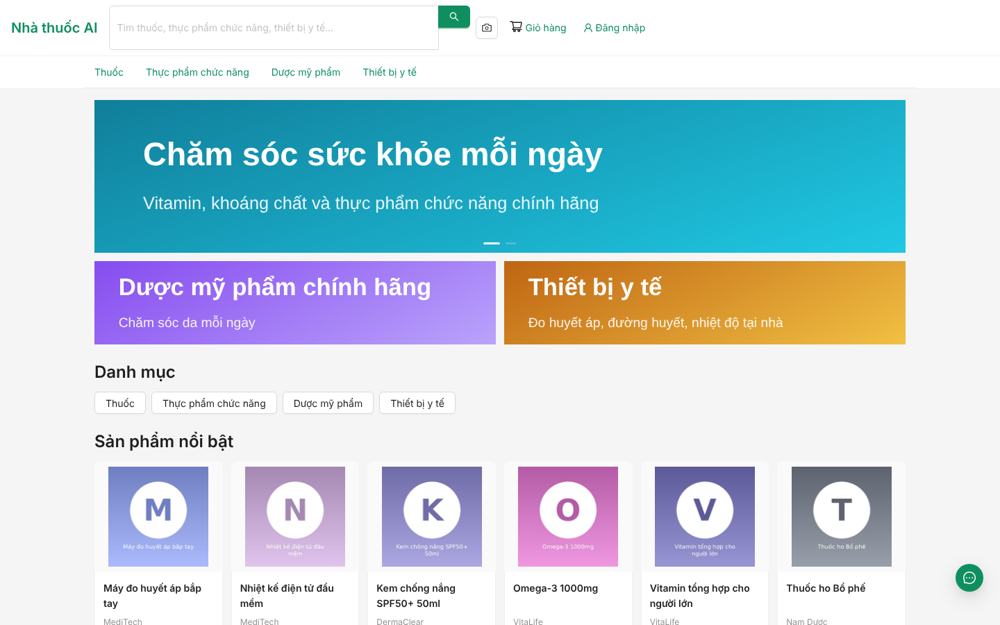
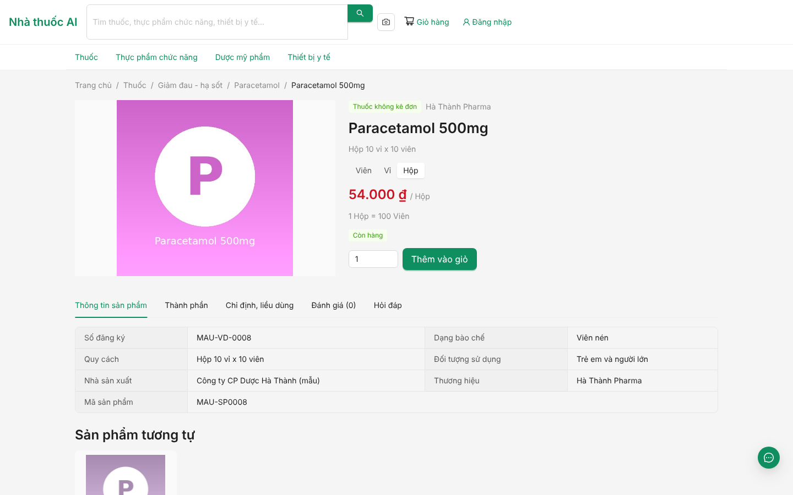
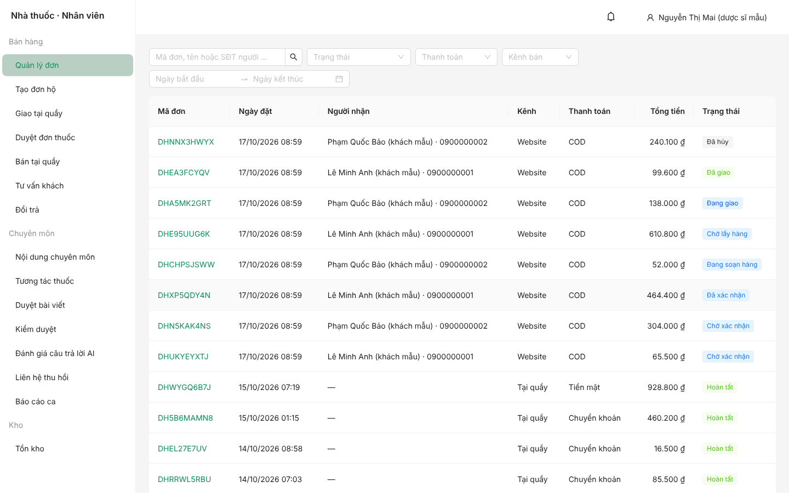
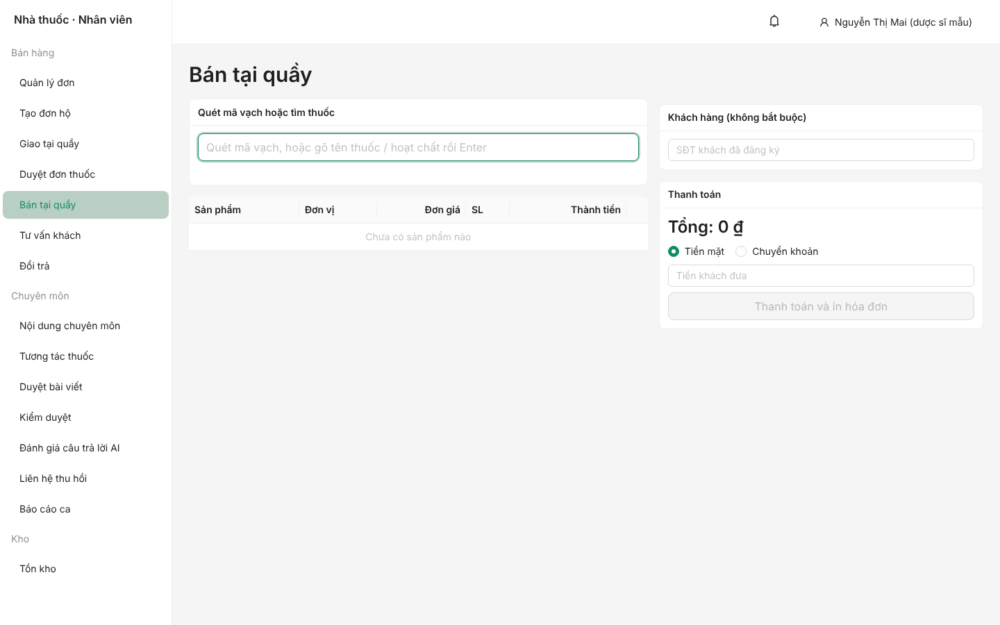
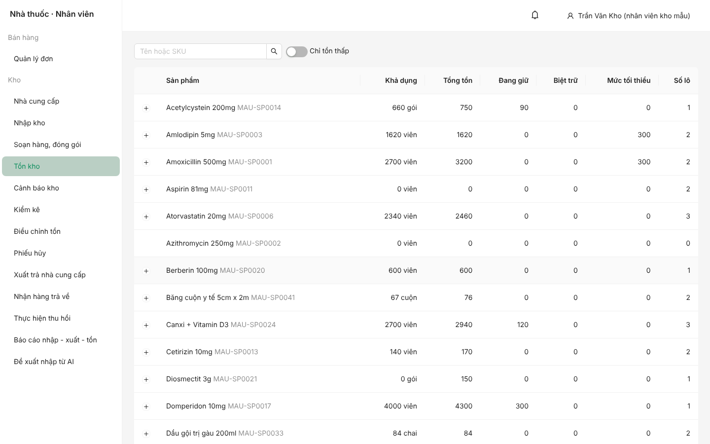
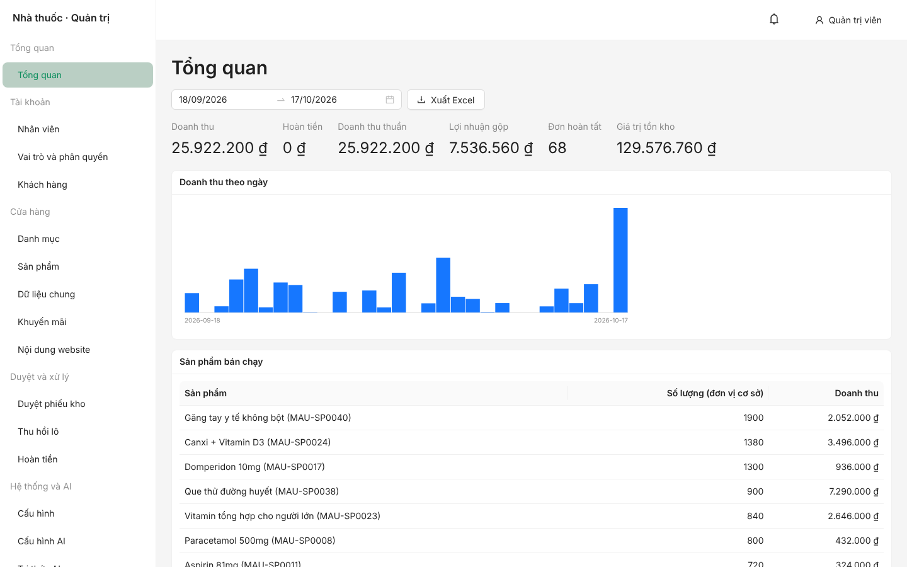

# Nhà thuốc AI: website bán thuốc tích hợp AI

Đồ án website nhà thuốc trực tuyến kiểu Long Châu (1 nhà thuốc = 1 kho): bán thuốc và sản phẩm sức khỏe, quản lý kho theo
lô và hạn dùng, xử lý đơn thuốc kê đơn qua dược sĩ, và tư vấn bằng AI có kiểm soát an toàn.



## Chức năng chính

| Nhóm | Nội dung |
|---|---|
| **Khách hàng** | Tìm kiếm và lọc sản phẩm, giỏ hàng, đặt hàng COD/VNPay/MoMo, theo dõi đơn, đổi trả và hoàn tiền, gửi đơn thuốc, hồ sơ sức khỏe và dị ứng |
| **Dược sĩ** | Xác nhận đơn, duyệt đơn thuốc kê đơn (có cảnh báo tương tác/dị ứng), bán tại quầy (POS), tư vấn trực tiếp qua chat, duyệt đổi trả, báo cáo ca |
| **Nhân viên kho** | Nhập kho theo lô, soạn hàng FEFO, đóng gói và vận đơn, kiểm kê, hủy hàng, xuất trả nhà cung cấp, thu hồi lô, đề xuất nhập hàng |
| **Admin** | Tài khoản và phân quyền, danh mục, sản phẩm, khuyến mãi, cấu hình, duyệt phiếu kho, xác nhận hoàn tiền, báo cáo, nhật ký, giám sát AI |
| **AI** | Chatbot tư vấn (Claude, có chuyển cho dược sĩ), tra cứu thuốc bằng ảnh hộp thuốc, đọc đơn thuốc, gợi ý sản phẩm, dự báo nhu cầu nhập, tìm kiếm theo ngữ nghĩa |

Mọi quy tắc an toàn chặn ở tầng service/SQL chứ không chỉ ở giao diện: thuốc kê đơn không vào giỏ và AI không gợi ý; admin không
đọc được dữ liệu sức khỏe; người lập phiếu khác người duyệt; tồn kho chỉ đổi qua một module có khóa dòng và ghi thẻ kho.

| | |
|---|---|
|  |  |
|  |  |



## Công nghệ

- **Backend:** Python 3.12, FastAPI, SQLAlchemy 2 (async), Alembic, Pydantic v2, quản lý gói bằng `uv`.
- **CSDL:** PostgreSQL 16 với `vector`, `unaccent`, `pg_trgm` (image `pgvector/pgvector:pg16`).
- **Frontend:** React 19, Vite, TypeScript, Ant Design 6, TanStack Query, React Router, Zustand.
- **AI:** Claude API (SDK `anthropic`, chỉ gọi qua `backend/app/ai/claude.py`), embedding BGE-M3 tự host.
- **Job nền:** APScheduler, chạy ở process riêng.
- **Tích hợp:** VNPay, MoMo, GHN, SMS/email; mọi tích hợp đều có adapter giả để chạy offline.

Đặc tả đầy đủ (nguồn sự thật của code) ở [`docs/spec/`](docs/spec/): kiến trúc, schema, phân quyền, nghiệp vụ, API, AI,
tích hợp, kiểm thử, lộ trình và các quyết định đã chốt.

## Chạy thử nhanh (dữ liệu demo)

Cần Docker, [`uv`](https://docs.astral.sh/uv/) và Node 22.

```bash
cp backend/.env.example backend/.env       # rồi điền JWT_SECRET, KHOA_MA_HOA, ADMIN_EMAIL, ADMIN_MAT_KHAU (cách sinh khóa có trong file)
docker compose up -d db mailpit            # Postgres + Mailpit (xem email tại http://localhost:8025)

cd backend
uv sync
uv run alembic upgrade head
uv run python -m app.seed --demo           # vai trò, quyền, 42 sản phẩm, ảnh minh họa, ~190 đơn trong 3 tháng
uv run uvicorn app.main:app --reload       # API: http://localhost:8000/docs
uv run python -m app.jobs                  # (tuỳ chọn, terminal khác) job nền

cd ../frontend
npm install
npm run dev                                # http://localhost:5173
```

`--demo` bao gồm `--mau` (danh mục, sản phẩm, lô hàng, khuyến mãi, bài viết, banner). Dữ liệu demo đi qua đúng API và mã nghiệp vụ
(bán tại quầy, đặt hàng, xác nhận, soạn, đóng gói, webhook vận chuyển giả) rồi dời mốc thời gian về quá khứ, nên tồn kho, thẻ kho, giá
vốn và báo cáo khớp nhau. Có đơn ở đủ các trạng thái: chờ xác nhận, đã xác nhận, đang soạn, chờ lấy hàng, đang giao, đã giao, hoàn
tất, đã hủy. Chạy lại khi đã có đơn thì bỏ qua.

### Tài khoản demo

Mật khẩu chung của tài khoản mẫu: `Mau@12345` (công khai, **chỉ dùng cục bộ**; seed từ chối nạp mẫu khi `MOI_TRUONG=production`).

| Vai trò | Đăng nhập | Địa chỉ |
|---|---|---|
| Khách hàng | `0900000001` hoặc `0900000002` | http://localhost:5173/dang-nhap |
| Dược sĩ | `duocsi@example.com` | http://localhost:5173/nhan-vien/dang-nhap |
| Nhân viên kho | `kho@example.com` | http://localhost:5173/nhan-vien/dang-nhap |
| Admin | `ADMIN_EMAIL` / `ADMIN_MAT_KHAU` trong `backend/.env` (phải đổi mật khẩu lần đầu) | http://localhost:5173/nhan-vien/dang-nhap |

Chế độ mặc định chạy hoàn toàn offline: AI giả (`AI_GIA_LAP=true`), embedding giả, VNPay/MoMo/GHN **mô phỏng đúng giao thức thật** (`THANH_TOAN_CHE_DO=mo_phong`, `VAN_CHUYEN_CHE_DO=mo_phong`: adapter thật +
máy chủ mô phỏng trong ứng dụng, gồm IPN có chữ ký, hoàn tiền, hủy vận đơn), SMS giả (OTP ghi ra log backend), email qua Mailpit.
Muốn dùng Claude thật: `AI_GIA_LAP=false` và `ANTHROPIC_API_KEY` trong `backend/.env`.

## Kiểm thử

```bash
cd backend && uv run ruff check . && uv run ruff format --check . && uv run pytest -q   # cần db đang chạy
cd frontend && npm run lint && npx tsc --noEmit && npm test -- --run && npm run build
./scripts/e2e.sh                                                                         # e2e Playwright
```

`scripts/e2e.sh` dựng lại CSDL riêng `nha_thuoc_e2e` bằng seed demo, bật backend và frontend rồi chạy 4 luồng chính trên trình
duyệt thật (không đụng CSDL dev):

1. Khách đặt COD → dược sĩ xác nhận → kho soạn và đóng gói → vận chuyển giao thành công.
2. Khách gửi đơn thuốc → dược sĩ duyệt và tạo đơn → khách xác nhận.
3. Khách đổi trả → dược sĩ duyệt → kho nhận hàng → dược sĩ tạo giao dịch hoàn → Admin xác nhận hoàn tiền.
4. Khách hỏi chatbot AI → chuyển dược sĩ → dược sĩ nhận và trả lời trực tiếp.

Cần `psql` và Chromium của Playwright (`npx playwright install chromium`, hoặc đặt `PW_CHROMIUM` trỏ tới trình duyệt có sẵn).
Chạy riêng một luồng: `./scripts/e2e.sh e2e/doi-tra.spec.ts`.

## Triển khai

Bản một máy bằng Docker Compose (nginx phục vụ frontend và chuyển `/api` tới backend, kể cả WebSocket/SSE):

```bash
cp .env.prod.example .env.prod             # điền bí mật thật, không commit
docker compose -f docker-compose.prod.yml --env-file .env.prod up -d --build
```

Dịch vụ: `db` (Postgres), `migrate` (chạy một lần: migration + seed cơ bản), `api`, `worker` (job nền, **chỉ một bản**), `web`
(nginx, cổng `WEB_PORT`). Dữ liệu nằm ở volume `pgdata` (CSDL) và `storage` (ảnh, tệp tải lên); hãy sao lưu cả hai.

Điểm cần lưu ý khi triển khai thật:

- **Chốt production:** `MOI_TRUONG=production` làm backend từ chối khởi động nếu còn cổng thanh toán/vận chuyển/SMS giả, thiếu
  `JWT_SECRET`, `KHOA_MA_HOA`, khóa cổng hay token webhook GHN, hoặc `COOKIE_SECURE=false`. Nghĩa là production cần tài khoản
  VNPay/MoMo/GHN thật và một nhà cung cấp SMS (`backend/app/tich_hop/tin_nhan/that.py` hiện chưa cài, vì spec để chọn lúc triển
  khai). Chưa có các thứ đó thì đặt `MOI_TRUONG=dev` để chạy bản demo với adapter giả, và không đưa dữ liệu khách thật vào.
- **HTTPS:** nginx trong compose chỉ nói HTTP; đặt thêm proxy TLS (Caddy, Traefik, nginx) phía trước. `COOKIE_SECURE=true` bắt buộc
  HTTPS, và nên bật HSTS ở proxy đó.
- **IP khách:** giới hạn tần suất dựa trên IP. nginx ghi đè `X-Forwarded-For` bằng IP thật và backend chạy với `--proxy-headers`, vì
  vậy **không mở cổng 8000 ra ngoài** (chỉ `web` được công khai). Nếu có thêm một proxy TLS phía trước nginx, cấu hình nginx lấy IP
  qua `real_ip_header`/`set_real_ip_from` thay vì dùng `$remote_addr`.
- **Kích thước tải lên:** nginx đặt `client_max_body_size 250m` (đủ cho 8 video đổi trả); backend tự giới hạn từng loại tệp.
- **Danh mục quyền:** `docs/spec/data/quyen.yaml` được đóng gói vào image backend; thiếu file này seed sẽ lỗi.
- **Mô hình embedding BGE-M3** là phụ thuộc tuỳ chọn nặng (`uv sync --extra ai-local`); mặc định chạy embedding giả.

## Cấu trúc thư mục

```
backend/      FastAPI (app/core, models, modules/<module>, tich_hop, ai, jobs, seed), tests/
frontend/     React (src/khu/{cua-hang,nhan-vien,quan-tri}, api, components, lib), e2e/
docs/spec/    Đặc tả 00-12, lộ trình và quyết định; docs/database: ERD; docs/anh: ảnh chụp màn hình
deploy/       Cấu hình nginx cho bản triển khai
scripts/      e2e.sh
```

Hướng dẫn demo từng kịch bản cho giảng viên: [`docs/HUONG_DAN_DEMO.md`](docs/HUONG_DAN_DEMO.md). Tài liệu ôn tập bảo vệ: [`docs/ON_TAP_BAO_VE.md`](docs/ON_TAP_BAO_VE.md). Bật Claude thật và thanh toán mô phỏng: [`docs/BAT_AI_THAT.md`](docs/BAT_AI_THAT.md).

Quy ước làm việc và các lệnh thường dùng: [`CLAUDE.md`](CLAUDE.md), [`backend/CLAUDE.md`](backend/CLAUDE.md),
[`frontend/CLAUDE.md`](frontend/CLAUDE.md).

## Giới hạn đã biết

- Chưa chạy với Claude API thật, mô hình BGE-M3 thật, VNPay/MoMo/GHN sandbox hay ảnh thuốc thật: test dùng bản giả. Cần thử các
  tích hợp này trước khi dùng.
- Chưa có bộ đánh giá chất lượng chatbot chạy với Claude thật (khung đánh giá có sẵn ở trang "Đánh giá câu trả lời AI").
- Các quyết định `QĐ-13` đến `QĐ-53` trong `docs/spec/12-quyet-dinh.md` do AI đề xuất khi làm từng task và chưa có người xác nhận.
- Danh sách việc còn mở (kể cả các phát hiện bảo mật mức thấp) nằm ở mục "Việc phát sinh" cuối `docs/spec/11-lo-trinh.md`.
